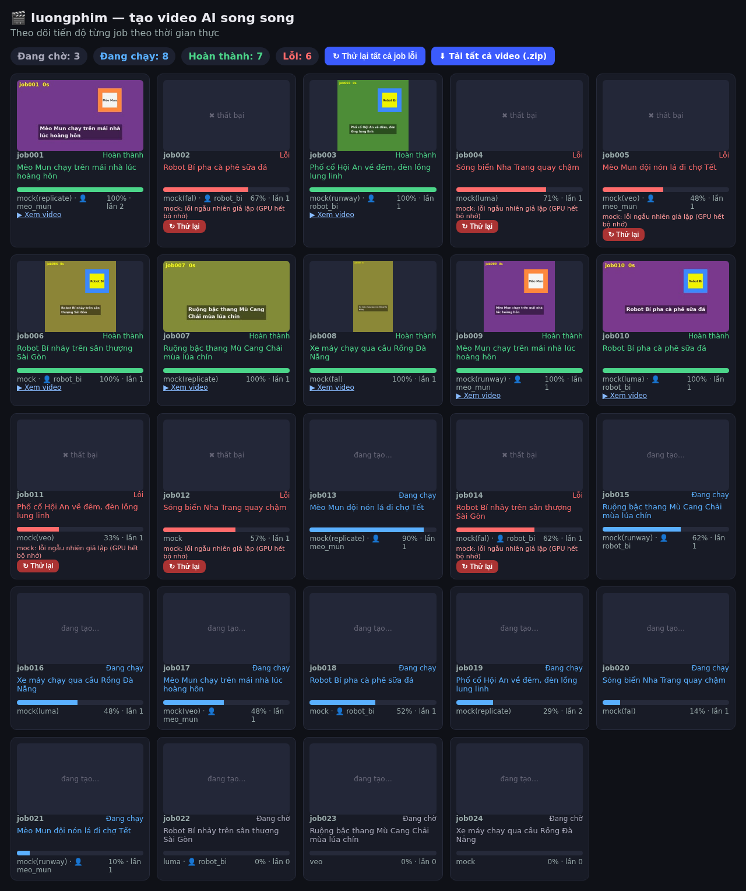

# luongphim

**luongphim** là công cụ dòng lệnh viết bằng Python giúp chạy **nhiều job tạo video AI cùng lúc** (asyncio), kèm một **dashboard web nhỏ chạy local** để theo dõi tiến độ, thử lại job lỗi và tải tất cả video đã xong thành một file zip.

> Đây là dự án nhỏ, phiên bản 0.1. Phần lõi (hàng đợi, giới hạn đồng thời, retry, provider mock, dashboard) đã được chạy và test. Các adapter cho dịch vụ thật được viết theo tài liệu REST công khai nhưng **chưa được thử với API key thật** (xem bảng bên dưới).



## Tính năng

- Hàng đợi job với **số job đồng thời cấu hình được** (`--concurrency`) và **giới hạn đồng thời riêng cho từng provider** (`max_concurrency`).
- Định nghĩa job trong file batch **JSON** (hoặc **YAML** nếu cài PyYAML): `prompt`, `duration`, `aspect`, `provider`, `character`, `name`, `repeat`.
- **Retry có backoff** (luỹ thừa + jitter, có giới hạn trên) khi gặp rate limit (HTTP 429, tôn trọng `Retry-After`), lỗi mạng hoặc lỗi 5xx. Lỗi không nên thử lại (4xx, nội dung bị từ chối…) thì dừng ngay.
- **Thư viện nhân vật**: tên → một hoặc nhiều ảnh tham chiếu. Job có `character` sẽ gửi ảnh tham chiếu cho provider hỗ trợ image-to-video.
- **Dashboard**: trạng thái từng job (đang chờ / đang chạy / hoàn thành / lỗi), thanh %, ảnh thumbnail, nút thử lại từng job hoặc tất cả job lỗi, nút tải zip toàn bộ video đã xong.
- **Provider mock** tự động được dùng khi không có API key: tạo **file MP4 thật** bằng ffmpeg (nền màu, chữ prompt, ảnh nhân vật chuyển động), có độ trễ giả lập, lỗi ngẫu nhiên và thỉnh thoảng giả lập 429 để thấy cơ chế retry.
- Không phụ thuộc thư viện ngoài khi chạy (chỉ dùng thư viện chuẩn Python + ffmpeg).

## Về tính nhất quán nhân vật (đọc kỹ)

Công cụ chỉ **chuyển ảnh tham chiếu** tới provider. Nhân vật có giống nhau giữa các video hay không **hoàn toàn phụ thuộc vào model của provider** và **không được đảm bảo**. Thường ảnh chỉ được dùng làm khung hình đầu (image-to-video), nên nhân vật có thể bị biến dạng hoặc thay đổi trong clip. Một số provider (ví dụ Luma trong adapter này) chỉ nhận URL ảnh công khai, nên ảnh local sẽ bị bỏ qua và có ghi chú trong dashboard.

## Cài đặt

Yêu cầu: Python 3.9+ và **ffmpeg** (cần cho mock và để tạo thumbnail).

```bash
# Ubuntu/Debian
sudo apt install ffmpeg
# macOS
brew install ffmpeg

git clone https://github.com/vietphan98/luongphim
cd luongphim
pip install -e .            # không kéo thêm thư viện nào
pip install -e ".[yaml]"    # nếu muốn dùng file batch YAML
```

## Cấu hình

### File batch

```yaml
settings:
  concurrency: 4          # số job chạy đồng thời tối đa
  max_retries: 3          # số lần thử lại tối đa mỗi job
  characters: characters.json
  providers:
    replicate: {max_concurrency: 2, model: minimax/video-01}
    veo: {max_concurrency: 1}
defaults:
  duration: 5
  aspect: "9:16"          # 16:9, 9:16, 1:1, 4:3, 3:4
jobs:
  - name: meo-mo-dau
    prompt: "Mèo Mun nhảy qua vũng nước, phong cách hoạt hình"
    provider: replicate
    character: meo_mun
  - prompt: "Phố đi bộ Nguyễn Huệ về đêm, góc máy flycam"
    provider: veo
    repeat: 3             # nhân bản job 3 lần
```

Xem thêm `examples/batch.yaml` và `examples/demo.json` (24 job).

### Thư viện nhân vật (`characters.json`)

```json
{
  "meo_mun": ["characters/meo_mun.png"],
  "robot_bi": ["characters/robot_bi.png", "https://example.com/robot.png"]
}
```

Đường dẫn tương đối tính từ thư mục chứa file json. Hiện adapter dùng ảnh **đầu tiên** của nhân vật.

### Biến môi trường (API key chỉ đọc từ đây)

| Provider | Biến môi trường |
|---|---|
| Replicate | `REPLICATE_API_TOKEN` |
| fal.ai | `FAL_KEY` |
| Runway | `RUNWAYML_API_SECRET` |
| Luma | `LUMAAI_API_KEY` |
| Google Veo (Gemini API) | `GEMINI_API_KEY` |

Nếu thiếu key của provider nào, job của provider đó tự chạy bằng **mock** (dashboard hiển thị `mock(tên_provider)`). Dùng `--mock` để ép tất cả chạy mock.

## Provider và tình trạng test

| Provider | API dùng | Ảnh nhân vật | Đã test với key thật? |
|---|---|---|---|
| mock | ffmpeg local | có (chèn ảnh vào clip) | ✅ đã chạy và có test tự động |
| Replicate | `POST /v1/models/{model}/predictions`, poll `urls.get` (mặc định `minimax/video-01`, trường `first_frame_image`) | có (data URI) | ❌ **CHƯA test với key thật** |
| fal.ai | Queue API `queue.fal.run/{model}` (mặc định Kling v1.6 text/image-to-video) | có (`image_url`) | ❌ **CHƯA test với key thật** |
| Runway | `POST /v1/image_to_video` + `/v1/tasks/{id}` (`gen4_turbo`) | **bắt buộc** có ảnh | ❌ **CHƯA test với key thật** |
| Luma | Dream Machine `/dream-machine/v1/generations` (`ray-2`) | chỉ URL công khai | ❌ **CHƯA test với key thật** |
| Google Veo | Gemini API `models/{model}:predictLongRunning` (mặc định `veo-3.0-generate-001`) | có (base64) | ❌ **CHƯA test với key thật** |

Lưu ý: tên model, tham số (thời lượng, tỉ lệ khung hình) và giá của các dịch vụ thay đổi thường xuyên; hãy kiểm tra tài liệu chính thức và chỉnh qua `settings.providers.<tên>` (ví dụ `model`, `extra_input`, `image_field`). Phần lớn API không trả % tiến độ, nên % trên dashboard cho các provider thật là **ước lượng theo thời gian chờ** (Runway có trả `progress` thì dùng giá trị thật). Gọi API thật sẽ **tốn tiền** theo bảng giá của từng dịch vụ.

## Sử dụng

```bash
luongphim examples/demo.json               # mở dashboard tại http://127.0.0.1:8765
luongphim examples/batch.yaml -c 3 --port 9000
luongphim examples/demo.json --mock --fail-rate 0.2 -o output_demo
python -m luongphim examples/demo.json --exit-when-done --no-browser
```

Tuỳ chọn chính: `-c/--concurrency`, `--characters`, `-o/--out`, `--port`, `--host`, `--mock`, `--retries`, `--fail-rate`, `--no-browser`, `--exit-when-done`. Sau khi chạy xong, dashboard vẫn mở để bạn thử lại job lỗi hoặc tải zip; nhấn Ctrl+C để thoát.

API của dashboard: `GET /api/jobs`, `POST /api/retry/<id>`, `POST /api/retry-failed`, `GET /download.zip`.

## Chạy test

```bash
pip install pytest
python -m pytest -q
```

Test bao phủ: giới hạn đồng thời toàn cục và theo provider, chạy song song thật sự, retry khi 429, hết lượt retry, lỗi không retry, backoff, thử lại thủ công, truyền ảnh nhân vật, đọc batch, tự chuyển sang mock khi thiếu key, mock tạo MP4 thật + thumbnail + dashboard + zip.

## Demo 20–30 giây để quay Reel

Đã chạy thử trên máy: 24 job, đồng thời 8, toàn bộ hàng đợi xong sau khoảng **18–22 giây**.

1. **0–3s**: mở terminal, chạy `luongphim examples/demo.json --fail-rate 0.2` (không cần API key). Trình duyệt tự mở dashboard.
2. **3–12s**: quay cảnh 8 thẻ "Đang chạy" cùng tăng %, thumbnail lần lượt hiện ra, vài job chuyển "Lỗi" màu đỏ.
3. **12–20s**: các job còn lại chạy xong, bộ đếm "Hoàn thành" tăng dần.
4. **20–24s**: bấm **"↻ Thử lại tất cả job lỗi"**, các thẻ đỏ quay lại "Đang chạy".
5. **24–30s**: bấm **"⬇ Tải tất cả video (.zip)"**, mở zip cho thấy các file MP4.

Ảnh chụp thật từ lần chạy demo: `docs/01-dang-chay.png`, `docs/02-giua-chung.png`, `docs/03-hoan-thanh.png`, `docs/04-thu-lai.png`.

**Hook cho Reel:** *"24 video AI, 1 lệnh, chạy song song — xem nè!"*

(Video trong demo là clip giả lập do ffmpeg tạo, không phải video AI thật.)

## Giấy phép bên thứ ba

- **Python** (thư viện chuẩn) – Python Software Foundation License.
- **FFmpeg** – công cụ ngoài được gọi qua dòng lệnh, không đóng gói kèm; LGPL 2.1+ (một số bản build là GPL, ví dụ khi có libx264). Bạn tự cài và tuân theo giấy phép của bản build mình dùng.
- **PyYAML** (tuỳ chọn, chỉ khi dùng file YAML) – MIT.
- **pytest** (chỉ để chạy test) – MIT.
- **Font DejaVu** (nếu có trên máy, dùng để vẽ chữ trong clip mock; không đóng gói kèm) – giấy phép Bitstream Vera / DejaVu (tự do).
- Các dịch vụ Replicate, fal.ai, Runway, Luma, Google Gemini API có điều khoản sử dụng riêng; bạn chịu trách nhiệm tuân thủ khi dùng API key của mình.

## Tác giả & giấy phép

Tác giả: **Việt Phan**. Phát hành theo giấy phép [MIT](LICENSE).
